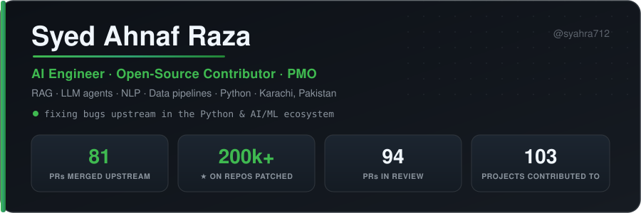

<picture>
  <source media="(prefers-color-scheme: light)" srcset="https://raw.githubusercontent.com/syahra712/syahra712/main/assets/hero-light.svg"/>
  
</picture>

I build **RAG systems, LLM agents and data pipelines**, and I fix bugs in the open-source projects they're built on. When something breaks in a library I depend on, I read the source, reproduce the bug and send the fix upstream.

**Right now**
- 🔧 Contributing across the **LLM-agent stack**, with PRs open in litellm, crewAI, dspy, smolagents, mem0 and markitdown
- 🔤 Building [**urdukit**](https://github.com/syahra712/urdukit), NLP tooling for Urdu, a language that 230M people speak and few libraries support
- 💼 PMO @ [VentureDive](https://pk.linkedin.com/company/venturedive) · Software Engineering @ Bahria University

---

## 🔧 Merged upstream

<!-- latest starts -->
**Latest merge:** [Accept plain lists and scalars in fill_flattened](https://github.com/scikit-hep/hist/pull/759) in **scikit-hep/hist** · 2026-11-13
<!-- latest ends -->

<!-- merged starts -->
| Project | ⭐ | Area | What I fixed |
|---|:--:|---|---|
| [**docling-project/docling**](https://github.com/docling-project/docling) | `71k` | document AI · VLMs | [Coerce MLX bfloat16 logprobs to float in VlmPredictionToken](https://github.com/docling-project/docling/pull/4005) |
| [**BerriAI/litellm**](https://github.com/BerriAI/litellm) | `63k` | LLM gateway · billing | [Don't retire a completed batch from cost recovery while output_file_id is lagging](https://github.com/BerriAI/litellm/pull/37715) |
| [**nltk/nltk**](https://github.com/nltk/nltk) | `15k` | machine learning | [Fix bare raise outside except block in sem.util.root_semrep](https://github.com/nltk/nltk/pull/3997) [Fix NameError in UndirectedTypeRaise.can_combine](https://github.com/nltk/nltk/pull/3999) |
| [**sshuttle/sshuttle**](https://github.com/sshuttle/sshuttle) | `14k` | networking · firewalls | [pf exclusions ignored under a wider include since rules became quick](https://github.com/sshuttle/sshuttle/pull/1270) [Skip hostwatch when the server has no os.fork](https://github.com/sshuttle/sshuttle/pull/1271) [Keep the tunnel up when a DNS or UDP reply cannot be sent](https://github.com/sshuttle/sshuttle/pull/1273) [Drop the zone id of a link-local nameserver from nft rules](https://github.com/sshuttle/sshuttle/pull/1272) [Reject an out-of-range --listen port with a clear error](https://github.com/sshuttle/sshuttle/pull/1312) [Report an invalid --listen value as a usage error](https://github.com/sshuttle/sshuttle/pull/1313) [Reject --tmark values that are not plain hex](https://github.com/sshuttle/sshuttle/pull/1314) [Match an IPv6 nameserver with /128, not /32](https://github.com/sshuttle/sshuttle/pull/1323) [Accept one-character namespace names and segments](https://github.com/sshuttle/sshuttle/pull/1322) [Report an invalid --remote port as a fatal error](https://github.com/sshuttle/sshuttle/pull/1320) [Ignore blank lines and indented comments in config files](https://github.com/sshuttle/sshuttle/pull/1319) [Set up a family that has nameservers but no subnets](https://github.com/sshuttle/sshuttle/pull/1321) |
| [**biopython/biopython**](https://github.com/biopython/biopython) | `5.3k` | bioinformatics | [Fix unformatted placeholder in double complement error message](https://github.com/biopython/biopython/pull/5393) |
| [**tox-dev/tox**](https://github.com/tox-dev/tox) | `4k` | Python test tooling | [Keep the packaging backend captured with --no-capture](https://github.com/tox-dev/tox/pull/4164) [Keep --no-index when an index URL follows it](https://github.com/tox-dev/tox/pull/4187) |
| [**pyro-ppl/numpyro**](https://github.com/pyro-ppl/numpyro) | `2.8k` | bayesian inference | [Parse JAX_ENABLE_X64 as a boolean string in enable_x64](https://github.com/pyro-ppl/numpyro/pull/2394) |
| [**aboutcode-org/scancode-toolkit**](https://github.com/aboutcode-org/scancode-toolkit) | `2.7k` | license compliance | [Cap pluggy below 1.7.0](https://github.com/aboutcode-org/scancode-toolkit/pull/5364) |
| [**Pyomo/pyomo**](https://github.com/Pyomo/pyomo) | `2.6k` | linear programming | [Fix UnboundLocalError in quadratic walker for InvalidNumber * zero-constant products](https://github.com/Pyomo/pyomo/pull/4063) |
| [**neuropsychology/NeuroKit**](https://github.com/neuropsychology/NeuroKit) | `2.4k` | biosignals | [Hrv_rsa(): compute RSA_PorgesBohrer on heart period, not heart rate](https://github.com/neuropsychology/NeuroKit/pull/1231) [Signal_formatpeaks(): drop every nan index together with its value](https://github.com/neuropsychology/NeuroKit/pull/1237) [Signal_flatline(): count a constant signal as flat](https://github.com/neuropsychology/NeuroKit/pull/1251) |
| [**ceph/ceph-ansible**](https://github.com/ceph/ceph-ansible) | `1.8k` | ansible | [Ceph_pool: fix arguments passed to list_pools()](https://github.com/ceph/ceph-ansible/pull/7744) |
| [**pybamm-team/PyBaMM**](https://github.com/pybamm-team/PyBaMM) | `1.7k` | batteries | [Fix kinetics `__all__` listing inverse kinetics submodules](https://github.com/pybamm-team/PyBaMM/pull/5970) |
| [**fossasia/voxbento**](https://github.com/fossasia/voxbento) | `1.5k` | web API · access control | [Scope admin transcript routes to the requested event](https://github.com/fossasia/voxbento/pull/813) |
| [**fossasia/veditor**](https://github.com/fossasia/veditor) | `1.5k` |  | [Show app INFO logs so the dev verification link is visible](https://github.com/fossasia/veditor/pull/317) |
| [**mpmath/mpmath**](https://github.com/mpmath/mpmath) | `1.2k` | arbitrary precision | [Flip rounding direction when negating in mpf_gamma(type=3) (fixes iv.loggamma)](https://github.com/mpmath/mpmath/pull/1204) [Respect directed rounding in mpf_atan2() (fixes iv.atan2 enclosures)](https://github.com/mpmath/mpmath/pull/1203) [Call lower_gamma() directly in the _gamma3() fallback (fixes #467)](https://github.com/mpmath/mpmath/pull/1210) [Evaluate fp.bessely() at integer order in mp context (fixes #497)](https://github.com/mpmath/mpmath/pull/1212) |
| [**pytroll/satpy**](https://github.com/pytroll/satpy) | `1.2k` | closember | [Fix debug log message for repeated record classes in eps_l1b reader](https://github.com/pytroll/satpy/pull/3506) |
| [**apache/iceberg-python**](https://github.com/apache/iceberg-python) | `1.2k` | apache | [Preserve null maps when projecting a map of structs](https://github.com/apache/iceberg-python/pull/4118) |
| [**guessit-io/guessit**](https://github.com/guessit-io/guessit) | `950` | filename | [Detect HDR10+](https://github.com/guessit-io/guessit/pull/972) |
| [**ArduPilot/pymavlink**](https://github.com/ArduPilot/pymavlink) | `743` |  | [Mavwp: keep legacy rally file altitude in metres](https://github.com/ArduPilot/pymavlink/pull/1316) |
| [**SciTools/iris**](https://github.com/SciTools/iris) | `730` | data analysis | [Show the offending object in CubeList non-cube error](https://github.com/SciTools/iris/pull/7348) |
| [**datalad/datalad**](https://github.com/datalad/datalad) | `677` | closember | [Close the reader pipe at EOF so an abandoned result generator does not leak FDs](https://github.com/datalad/datalad/pull/7971) [LineSplitter: do not split a CRLF that arrives in two chunks](https://github.com/datalad/datalad/pull/7989) [Ensure_list_from_str: drop empty items, so a multi-line url_re no longer matches every URL](https://github.com/datalad/datalad/pull/7995) |
| [**pymc-devs/pytensor**](https://github.com/pymc-devs/pytensor) | `650` | ai | [Index 0-d MakeVector inputs instead of calling .item() in numba](https://github.com/pymc-devs/pytensor/pull/2503) |
| [**mozilla/bugbug**](https://github.com/mozilla/bugbug) | `580` | agentic ai | [Keep full comment text when rendering Phabricator revisions](https://github.com/mozilla/bugbug/pull/7197) |
| [**GoogleCloudPlatform/professional-services-data-validator**](https://github.com/GoogleCloudPlatform/professional-services-data-validator) | `537` |  | [Convert Impala connection options given as strings to their real types](https://github.com/GoogleCloudPlatform/professional-services-data-validator/pull/1852) [Use UTF-8 for stdout so non-ASCII results can be printed on Windows](https://github.com/GoogleCloudPlatform/professional-services-data-validator/pull/1853) [Do not split --filters on PostgreSQL style :: type casts](https://github.com/GoogleCloudPlatform/professional-services-data-validator/pull/1861) [Ignore a target primary key with columns missing from the source](https://github.com/GoogleCloudPlatform/professional-services-data-validator/pull/1870) [Keep the requested log level when a deprecated option is used](https://github.com/GoogleCloudPlatform/professional-services-data-validator/pull/1868) [Fail configs list when no validation YAML files are found](https://github.com/GoogleCloudPlatform/professional-services-data-validator/pull/1869) [Keep NULL binary UUIDs as NULL when casting them to strings](https://github.com/GoogleCloudPlatform/professional-services-data-validator/pull/1872) [Trim spaces around items in comma separated column arguments](https://github.com/GoogleCloudPlatform/professional-services-data-validator/pull/1883) [List the files in a GCS directory given without a trailing slash](https://github.com/GoogleCloudPlatform/professional-services-data-validator/pull/1874) [Only replace the leading zero in Oracle and Db2 strftime %e](https://github.com/GoogleCloudPlatform/professional-services-data-validator/pull/1871) |
| [**readthedocs/sphinx-autoapi**](https://github.com/readthedocs/sphinx-autoapi) | `497` |  | [Fix recursion when a nested class inherits from its enclosing class](https://github.com/readthedocs/sphinx-autoapi/pull/572) [Fix method signatures when self is positional-only or absent](https://github.com/readthedocs/sphinx-autoapi/pull/577) |
| [**fortran-lang/fortls**](https://github.com/fortran-lang/fortls) | `350` | fortls | [Handle mixed quotes in find_paren_match](https://github.com/fortran-lang/fortls/pull/569) |
| [**wradlib/wradlib**](https://github.com/wradlib/wradlib) | `324` | hacktoberfest | [Show filename in read_gamic_hdf5 error for non-GAMIC files](https://github.com/wradlib/wradlib/pull/803) |
| [**gammapy/gammapy**](https://github.com/gammapy/gammapy) | `295` | astronomy | [Fix missing f-prefix in two error messages](https://github.com/gammapy/gammapy/pull/6918) [Fix to_dict() for big-endian arrays in four models](https://github.com/gammapy/gammapy/pull/6952) |
| [**openSUSE/opi**](https://github.com/openSUSE/opi) | `290` | cli | [Fetch file:// and $releasever gpgkeys correctly when asking to keep a key](https://github.com/openSUSE/opi/pull/227) |
| [**scikit-hep/uproot**](https://github.com/scikit-hep/uproot) | `274` | analysis | [Handle negative and out-of-range indexes in TAxis.__getitem__](https://github.com/scikit-hep/uproot/pull/1765) [Write RNTuple data whose lists are all empty](https://github.com/scikit-hep/uproot/pull/1812) |
| [**StingraySoftware/stingray**](https://github.com/StingraySoftware/stingray) | `227` | astronomy | [Fix gti __all__ entry and accept list GTIs in get_btis](https://github.com/StingraySoftware/stingray/pull/991) [Fix vertical hue lines and ref_angle in power-color state labels](https://github.com/StingraySoftware/stingray/pull/999) [Keep fractional counts when rebinning integer data](https://github.com/StingraySoftware/stingray/pull/1007) |
| [**getmail6/getmail6**](https://github.com/getmail6/getmail6) | `173` |  | [#277: malformed POP3 UIDL/LIST aborts only the affected account](https://github.com/getmail6/getmail6/pull/284) [#281: clear IMAP mailbox state when EXPUNGE fails in close_mailbox](https://github.com/getmail6/getmail6/pull/290) [Multidrop IMAP: keep an encoded envelope header as one text value](https://github.com/getmail6/getmail6/pull/292) [Report malformed tuple settings as configuration errors](https://github.com/getmail6/getmail6/pull/293) [Use an absolute uid_cache file name instead of ignoring it](https://github.com/getmail6/getmail6/pull/294) [Parse IMAP LIST responses with a NIL delimiter or mixed-case flags](https://github.com/getmail6/getmail6/pull/295) [Don't crash when a filter or MDA writes non-UTF-8 text to stderr](https://github.com/getmail6/getmail6/pull/296) |
| [**theochem/iodata**](https://github.com/theochem/iodata) | `173` | computational biology | [Keep MOL2 atomic charges when a status bit follows them](https://github.com/theochem/iodata/pull/410) [Compare MWFN electron counts with a tolerance](https://github.com/theochem/iodata/pull/432) |
| [**scikit-hep/particle**](https://github.com/scikit-hep/particle) | `167` | analysis | [R-parity of squarks and sleptons](https://github.com/scikit-hep/particle/pull/811) [Format negative values in str_with_unc](https://github.com/scikit-hep/particle/pull/827) |
| [**scikit-hep/hist**](https://github.com/scikit-hep/hist) | `140` | histogram | [Raise for missing exact names in wildcard category lists](https://github.com/scikit-hep/hist/pull/738) [Accept NumPy integer arrays in from_columns](https://github.com/scikit-hep/hist/pull/748) [Support dividing a Stack by a scalar or array](https://github.com/scikit-hep/hist/pull/761) [Accept plain lists and scalars in fill_flattened](https://github.com/scikit-hep/hist/pull/759) |
| [**openfoodfacts/open-prices**](https://github.com/openfoodfacts/open-prices) | `111` | crowdsourcing | [API: accept `location_id` when updating a proof](https://github.com/openfoodfacts/open-prices/pull/1476) |
| [**theochem/grid**](https://github.com/theochem/grid) | `102` | clenshaw curtis | [Return an empty LocalGrid when no point is within the radius](https://github.com/theochem/grid/pull/344) [Accept NumPy integers when indexing Grid, OneDGrid and PeriodicGrid](https://github.com/theochem/grid/pull/346) |
| [**ga4gh/vrs-python**](https://github.com/ga4gh/vrs-python) | `66` | bioinformatics | [Reject trailing input in beacon, gnomAD and SPDI translators](https://github.com/ga4gh/vrs-python/pull/670) [Handle indefinite Range bound of 0 in normalize](https://github.com/ga4gh/vrs-python/pull/688) |
| [**pypa/distlib**](https://github.com/pypa/distlib) | `66` | Python packaging | [Use the Python-2.0.1 SPDX license identifier](https://github.com/pypa/distlib/pull/276) |
| [**sugarlabs/www-v2**](https://github.com/sugarlabs/www-v2) | `65` | hacktoberfest | [Redirect /music-blocks to /musicblocks](https://github.com/sugarlabs/www-v2/pull/1082) |
| [**scipy/xsf**](https://github.com/scipy/xsf) | `43` |  | [Smirnovp: avoid int overflow in derivative coefficient for large n](https://github.com/scipy/xsf/pull/320) |
| [**pyccel/sympde**](https://github.com/pyccel/sympde) | `25` | finite elements | [Keep the physical dimension of mappings in Domain.export / Domain.from_file](https://github.com/pyccel/sympde/pull/201) |
| [**arviz-devs/arviz-stats**](https://github.com/arviz-devs/arviz-stats) | `18` |  | [Stabilize stacking weights against overflow in exp of pointwise ELPD](https://github.com/arviz-devs/arviz-stats/pull/501) [Fit the left Pareto tail correctly for unsigned integer draws](https://github.com/arviz-devs/arviz-stats/pull/538) |
| [**SciTools/ncdata**](https://github.com/SciTools/ncdata) | `16` |  | [Replace deprecated licence config in pyproject.toml](https://github.com/SciTools/ncdata/pull/268) |
| [**konflux-ci/rpm-lockfile-prototype**](https://github.com/konflux-ci/rpm-lockfile-prototype) | `16` |  | [Handle registry port numbers in image specs](https://github.com/konflux-ci/rpm-lockfile-prototype/pull/184) [Add --tls-verify option for skopeo calls](https://github.com/konflux-ci/rpm-lockfile-prototype/pull/186) [Remove the temporary rpmdb cache directory when it is not used](https://github.com/konflux-ci/rpm-lockfile-prototype/pull/189) [Honour false/no spellings of 'enabled' in .repo files](https://github.com/konflux-ci/rpm-lockfile-prototype/pull/188) [Pass --tls-verify to skopeo when loading variables from images](https://github.com/konflux-ci/rpm-lockfile-prototype/pull/187) [Treat images without labels as having no variables](https://github.com/konflux-ci/rpm-lockfile-prototype/pull/191) [Do not retry with filelists when they were already downloaded](https://github.com/konflux-ci/rpm-lockfile-prototype/pull/192) [Treat only http(s):// locations as URLs in repo files](https://github.com/konflux-ci/rpm-lockfile-prototype/pull/193) [Raise a clear error when no compose matches the filters](https://github.com/konflux-ci/rpm-lockfile-prototype/pull/194) |
| [**fossology/fossology-python**](https://github.com/fossology/fossology-python) | `15` | automation | [Don't send "None" as the folder description](https://github.com/fossology/fossology-python/pull/212) |
| [**plone/plone.event**](https://github.com/plone/plone.event) | `5` |  | [Pass re.MULTILINE to re.sub as flags, not as count](https://github.com/plone/plone.event/pull/71) |
| [**apache/solr-orbit**](https://github.com/apache/solr-orbit) | `3` | apache | [Build the Docker image on Python 3.13, inside requires-python](https://github.com/apache/solr-orbit/pull/126) [Page through collections with SolrClient.search in create-workload](https://github.com/apache/solr-orbit/pull/125) [Restore metrics.metrics_store_class so solr-orbit stop works again](https://github.com/apache/solr-orbit/pull/124) [Create ClusterEnvironmentInfo so --telemetry cluster-environment-info works](https://github.com/apache/solr-orbit/pull/135) [Add a make licenses target that generates THIRD_PARTY.md](https://github.com/apache/solr-orbit/pull/133) [Count failed bulk-index batches once in the reported weight](https://github.com/apache/solr-orbit/pull/151) [Report raw-request HTTP errors as failed requests](https://github.com/apache/solr-orbit/pull/152) [Show a three-node cluster example in the quickstart](https://github.com/apache/solr-orbit/pull/132) |
| [**apache/solr-orbit-workloads**](https://github.com/apache/solr-orbit-workloads) | `2` | apache | [Nyc_taxis: draw randomized dates from each operation's facet window](https://github.com/apache/solr-orbit-workloads/pull/23) |
<!-- merged ends -->

<!-- review starts -->

<b>🕐 In review: 118 PRs across 80 projects</b>, including markitdown, mem0, litellm, crewAI, agno, dspy, smolagents…

 

| Project | ⭐ | Fix |
|---|:--:|---|
| [microsoft/markitdown](https://github.com/microsoft/markitdown/pull/2302) | `195k` | Refactor ImageConverter to reuse llm_caption helper |
| [mem0ai/mem0](https://github.com/mem0ai/mem0/pull/7001) | `69k` | Dispatch add_embeddings on actual signature |
| [BerriAI/litellm](https://github.com/BerriAI/litellm/pull/45952) | `63k` | Route GPT-5.4+ function-tool calls through the Responses API |
| [crewAIInc/crewAI](https://github.com/crewAIInc/crewAI/pull/8040) | `61k` | Opt-in deferred tool loading via Responses tool search |
| [agno-agi/agno](https://github.com/agno-agi/agno/pull/9596) | `43k` | Chain exception causes in tool, model, and vectordb error paths |
| [stanfordnlp/dspy](https://github.com/stanfordnlp/dspy/pull/10227) | `39k` | Add sort_keys=True to tool call/result JSON serialization |
| [huggingface/smolagents](https://github.com/huggingface/smolagents/pull/2950) | `30k` | Accept AgentImage/AgentAudio state values for image/audio tool inputs |
| [ArduPilot/ardupilot](https://github.com/ArduPilot/ardupilot/pull/34806) | `16k` | Tools: param_unpack.py: support param.pck files with defaults |
| [nltk/nltk](https://github.com/nltk/nltk/pull/4021) | `15k` | Replace Python 2 protocol methods and stale names that Python 3 never reaches |
| [pyro-ppl/pyro](https://github.com/pyro-ppl/pyro/pull/3500) | `9.1k` | Restore deep_getattr in pyro.infer.autoguide.utils |
| [arrow-py/arrow](https://github.com/arrow-py/arrow/pull/1391) | `9.1k` | Use calendar months for humanize month and quarter granularity |
| [marshmallow-code/marshmallow](https://github.com/marshmallow-code/marshmallow/pull/3073) | `7.2k` | Reject leading/trailing hyphen in the last domain label in validate.Email |

[See every open PR →](https://github.com/pulls?q=is%3Apr%20is%3Aopen%20author%3Asyahra712%20-user%3Aahnaf-lab%20-user%3Asyahra712)

<!-- review ends -->

This section updates itself every 6 hours from the GitHub API. See [`scripts/update.py`](scripts/update.py).

---

## 🚀 Things I've built

<table>
<tr>
<td width="50%" valign="top">

### [🔤 urdukit](https://github.com/syahra712/urdukit)
A zero-dependency **Urdu NLP toolkit** for normalization, tokenization, stopwords, stemming and Roman-Urdu transliteration. `pip install` and go: no TensorFlow and no model downloads.

`Python` `NLP` `low-resource languages`

</td>
<td width="50%" valign="top">

### [🛠️ HizmatAI](https://github.com/syahra712/aihack-hizmatai)
A two-sided **agentic booking platform** for Pakistan's informal economy. A 6-agent Google ADK pipeline on Gemini connects customers with home-service providers in Urdu, Roman-Urdu and English.

`multi-agent` `Flutter` `FastAPI` `React`

</td>
</tr>
<tr>
<td valign="top">

### [🕸️ Graph-Augmented Research Agent](https://github.com/syahra712/Graph-Augmented-Intelligent-Research-Agent)
A research agent that goes beyond plain RAG: it combines embedding similarity with **co-citation and bibliographic coupling** for literature search, gap analysis, plagiarism detection and citation formatting.

`RAG` `citation graphs` `LLM agents`

</td>
<td valign="top">

### [🌫️ AQI forecasting pipeline](https://github.com/syahra712/AQI10Pearls)
An end-to-end **MLOps** pipeline. Scheduled ingestion feeds a Hopsworks feature store, models retrain automatically, and a live dashboard shows the forecasts, all running on GitHub Actions.

`MLOps` `feature store` `time series`

</td>
</tr>
<tr>
<td valign="top">

### [🫥 hiddenink](https://github.com/syahra712/hiddenink)
*Find the ink you can't see.* It detects and cleans invisible Unicode, homoglyphs and container metadata, and decides for each occurrence whether the character is a hidden mark or real content.

`Python` `text security` `zero-dep`

</td>
<td valign="top">

### [🌳 yaadain](https://github.com/syahra712/yaadain)
A living **family tree for Urdu-speaking elders with memory loss**. It's an offline-first Flutter app built for reminiscence and simulated-presence therapy.

`Flutter` `Dart` `health`

</td>
</tr>
</table>

More: [BridgeSign](https://github.com/syahra712/AIProject-BridgeSign) (real-time ASL recognition) · [EcoViz](https://github.com/syahra712/DataVisualzationEcoViz) (emissions dashboards and model benchmark) · [TumorVision](https://github.com/syahra712/PEC-Hackathon) (MRI classification with Grad-CAM) · [AES-RSA](https://github.com/syahra712/AES-RSA) (hybrid encryption service)

---

## 🎖️ Experience & credentials

| | |
|---|---|
| 💼 **Experience** | PMO @ **VentureDive** · Technical APM @ **CodeAvenue** · RAG / LLM systems @ **Sybrid** · ML pipelines @ **10Pearls** |
| 🏆 **Awards** | Regional Winner, **National Agentic AI Hackathon** |
| 📜 **Certs** | Oracle **Generative AI Professional** · Stanford **ML Specialization** · Microsoft **PL-300** · Google **Project Management** |
| 🌱 **Leadership** | Hult Prize Campus Director · VP, Bahria University Development Society |

## 🛠️ Stack

| | |
|---|---|
| **AI / ML** | PyTorch · TensorFlow · Hugging Face · LangChain · Google ADK · spaCy · RAG · LLM agents |
| **Languages** | Python · TypeScript · JavaScript · Dart · SQL |
| **Build & ship** | FastAPI · React · Next.js · Flutter · Docker · MongoDB · GitHub Actions · n8n |

---

Open to <b>AI/ML engineering</b> and <b>applied AI project management</b> roles · If you maintain a Python project and have a gnarly bug, I'd like to hear about it.

